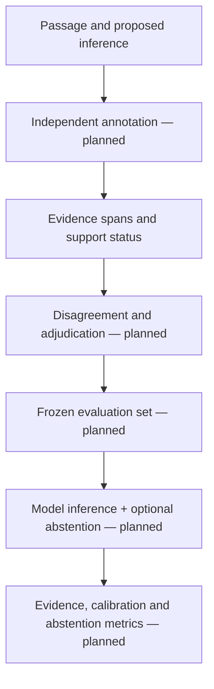

# Cognitive Mirror
### An evidence-aware benchmark design for psychological inference and abstention in language models

**Human–AI interaction · Language-model evaluation · Evidence sufficiency · Uncertainty**

> **Status: research design and protocol scaffold (2026).** This repository does **not** contain a collected or independently annotated benchmark, human-subject data, trained model, clinical instrument, or measured LLM performance. All example passages are constructed demonstrations.

## The research question

**Can a language model distinguish an interpretation supported by text from a plausible psychological narrative that the text does not justify—and abstain when the evidence is insufficient?**

Language models can produce compelling explanations of what someone thinks, feels, or intends after seeing a very short passage. Fluency is not evidence. Cognitive Mirror is proposed to measure not only the *plausibility* of a proposed interpretation, but also its textual support, calibration, explicit evidence citation and willingness to withhold unsupported conclusions.

## What is currently proposed (not achieved)

| Design target | Proposed plan | Actual release status |
|---|---|---|
| Dataset size | Approximately **1,500–3,000 passages** | **Not collected** |
| Hard negatives | **At least 30%** of planned items | **Not assembled or measured** |
| Independent annotations | **Three annotators per item** | **Not recruited or completed** |
| Evidence support | Annotators mark supporting text spans | Proposed schema and guidance only |
| Evaluation | Macro-F1, evidence overlap, calibration, per-category precision, selective prediction and abstention quality | No model evaluation conducted |
| Evaluation splits | Frozen held-out split before testing | Not created |

The numbers above are **design targets from the existing [portfolio case study](https://github.com/iharkeerat/harkeerat-singh/blob/main/docs/case-studies/cognitive-mirror.html)**. No results are implied.

## What this repository *actually* contains

- A **research protocol** and scope decisions for separating directly supported statements from unwarranted mental-state inferences.
- A **draft annotation codebook** and evidence-span conventions, explicitly provisional.
- An **evaluation plan** distinguishing overall correctness from calibration, evidence quality, and abstention.
- **Ethics, privacy and dataset-governance safeguards** for any later participant or public-text collection.
- **Four synthetic examples** (not part of any benchmark) plus a standard-library schema validator and tests to make the proposed format inspectable.
- **Preregistration and review templates** to make unfinished methodological choices visible.

## Repository map

| Resource | Purpose |
|---|---|
| [Research question](docs/research-question.md) | Motivation, estimands, and scope |
| [Study protocol](docs/benchmark-protocol.md) | Planned stages, sampling and adjudication |
| [Annotation codebook](docs/annotation-guidelines.md) | Draft evidence and abstention coding rules |
| [Evaluation plan](docs/evaluation-plan.md) | Pre-specifiable metrics and baseline comparisons |
| [Data governance](docs/data-governance.md) | Collection, consent, licensing, access and splits |
| [Ethics and safeguards](docs/ethics-and-safety.md) | Risks of over-interpreting people, privacy, group fairness |
| [Claims and evidence](docs/claims-and-evidence.md) | What is demonstrated versus merely planned |
| [Preregistration template](docs/preregistration-template.md) | Empty decisions for prospective study registration |
| [Synthetic examples](examples/synthetic_examples.jsonl) | Demonstrations only—not data or validated labels |
| [Example validator](tools/validate_examples.py) | Checks JSONL shape, span integrity and invariants |
| [Project status](PROJECT_STATUS.md) | Development phase and uncompleted work |
| [Limitations](LIMITATIONS.md) | What the design cannot establish |

## Conceptual workflow



**None of the annotation, adjudication, frozen-set or model-evaluation steps above has been reported as completed.**

## Run the scaffold locally

Only Python 3.10+ is required, with no external packages or model API keys:

```bash
python tools/validate_examples.py examples/synthetic_examples.jsonl
python -m unittest discover -s tests -v
```

These commands only validate the structure of four **constructed examples**. They are **not benchmarks**, performance measurements, or evidence that a language model interprets human psychology correctly.

## Scientific and ethical boundaries

Cognitive Mirror is a proposed **textual evidence-sufficiency benchmark**, not a tool for diagnosing mental illness, detecting deception, evaluating employee suitability, establishing intent in legal disputes, or inferring sensitive personal traits. Even agreement between annotators cannot reveal someone's private mental state. Human review, appropriate permissions, privacy controls, independent ethics assessment and clearly defined constructs are prerequisites for any future real-text study.

## Authorship and attribution

**Harkeerat Singh** · Independent research project · 2026. The public design is based on the author's existing case study; this repository's scaffold and documentation were prepared with AI assistance under author direction. No institutional endorsement, peer review, human annotation or completed experiment is asserted.

See [rights and reuse](RIGHTS_AND_REUSE.md) and [citation information](CITATION.cff). Feedback is welcome through [contribution guidance](CONTRIBUTING.md).

**A persuasive interpretation is not necessarily a justified one.**